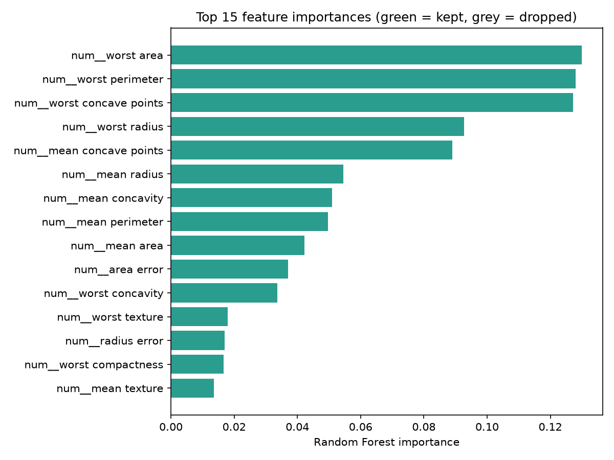
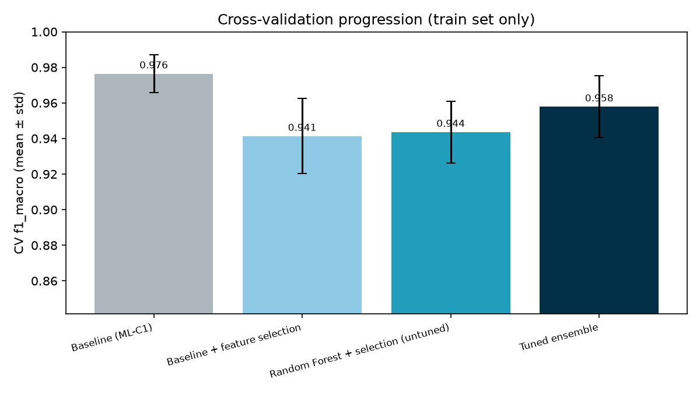
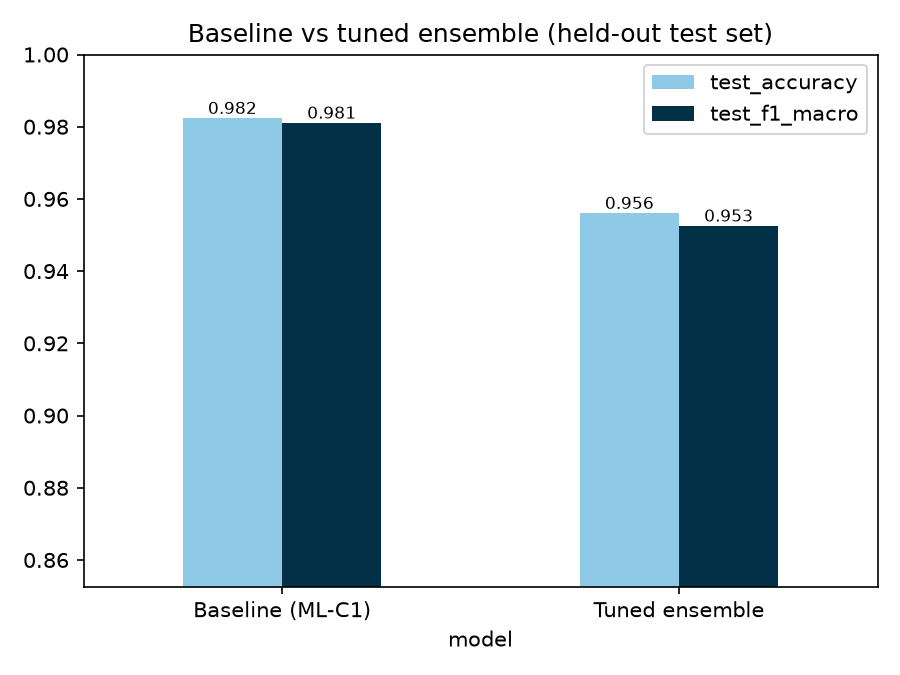
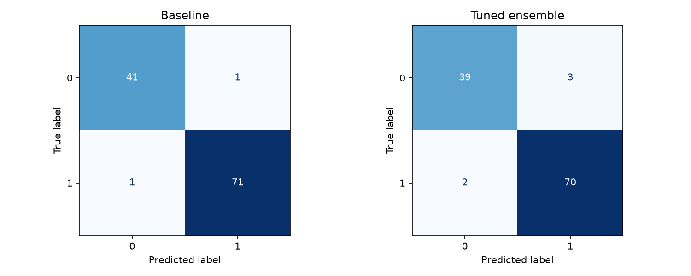

# Tuned Ensemble Pipeline 

Improving my ML-C1 baseline with feature selection, an ensemble model and systematic hyperparameter tuning.

## Problem & data
- **Dataset:** Breast Cancer Wisconsin (Diagnostic), loaded from scikit-learn (`load_breast_cancer`, originally from the UCI Machine Learning Repository). 569 rows, 30 numeric feature columns plus 1 target column.
- **Task:** Binary classification: predict whether a tumour is malignant (212 samples) or benign (357 samples) from measurements of cell nuclei.
- **Metric:** F1-macro (same metric as ML-C1). Accuracy is reported as a secondary metric.
## How to run
```bash
pip install -r requirements.txt
# put your CSV at data/data.csv and set TARGET in tuned_ensemble.py
python tuned_ensemble.py
```
Everything is seeded (`SEED = 42`), so results are reproducible. Plots go to `images/`, tables to `results/`.

## Method
1. **Baseline (ML-C1):** <model, preprocessing, score>
2. **Feature selection:** Random Forest importances with `SelectFromModel` (threshold tuned). Done *inside* the pipeline so each CV fold selects features from its own training data only.
3. **Ensemble:** Random Forest on the selected features.
4. **Tuning:** `RandomizedSearchCV`, 40 iterations, 5-fold stratified CV on the training set. Search space: `n_estimators`, `max_depth`, `min_samples_split`, `min_samples_leaf`, `max_features`, selection threshold. Full log: `results/search_results.csv`.
5. **Final evaluation:** held-out 20% test set, used **once**.

## Avoiding data leakage
- Train/test split happens before any fitting.
- Imputation, scaling, encoding and feature selection are fitted inside CV folds via `Pipeline`.
- The test set was never used for tuning or selection.

## Feature selection evidence
<which features were kept/dropped and why; see `results/feature_selection.csv`>



## Results
**CV progression (train set)**



**Before vs after (held-out test set)**

| Model | Accuracy | F1-macro |
|---|---|---|
| Baseline (ML-C1) | 0.9825 | 0.9812 |
| Tuned ensemble | 0.9561 | 0.9526 |




Best configuration: see `results/best_params.json`.

## Discussion
<what improved, by how much, whether the gain exceeds the CV std, limitations>
